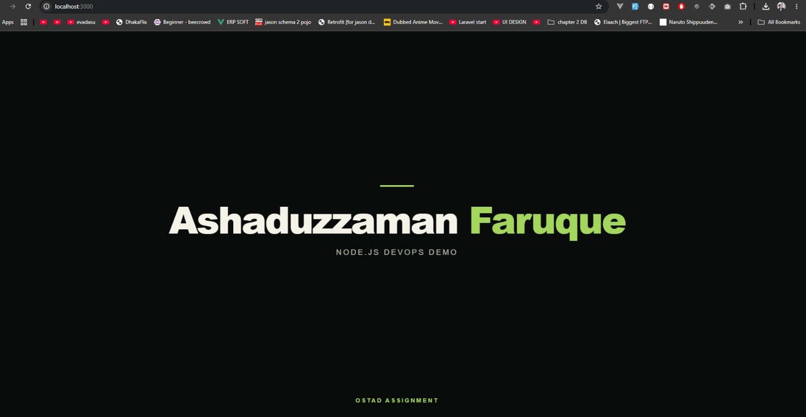
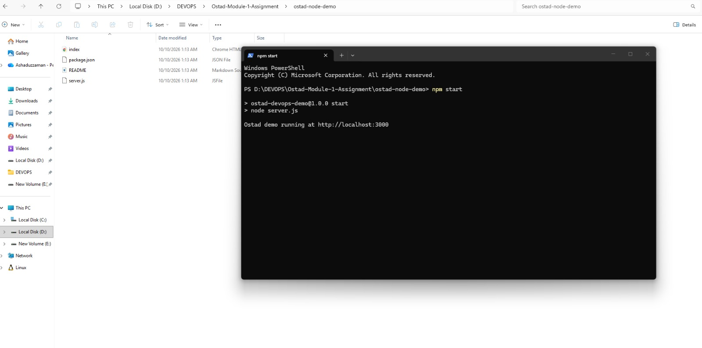
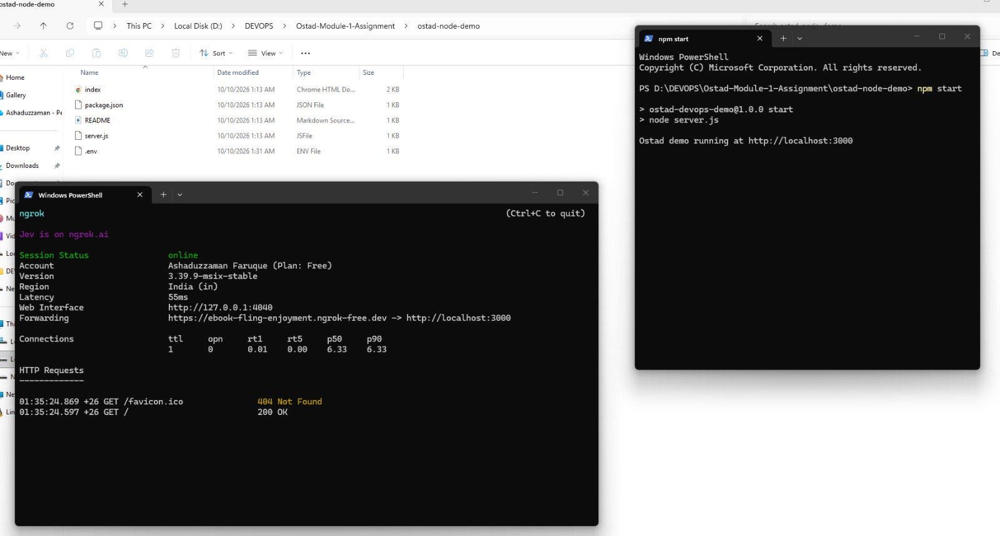
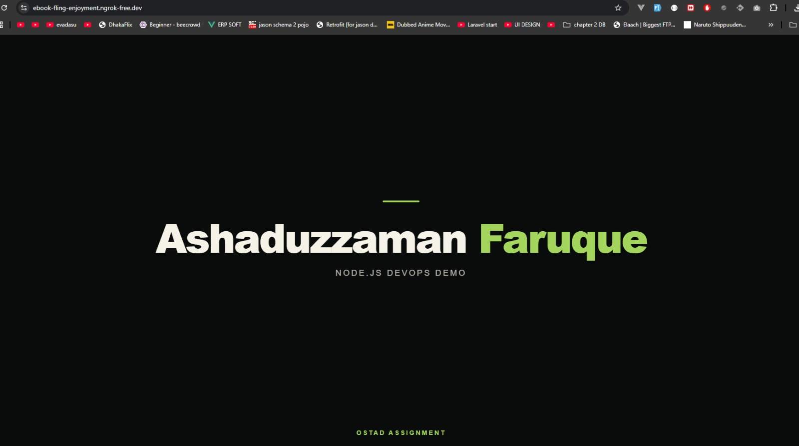

# Part C: Technical / Practical Tasks

## Task 1: Local DevOps Demo Application

### Answer

I created a simple Node.js application for my Ostad DevOps Assignment.

I ran the application on my local computer using the following command:

```bash
npm start
```

**Local URL:** [http://localhost:3000](http://localhost:3000)

After running the command, I opened the URL in my browser. The application was running successfully.

### Why is running an application locally important?

Running an application locally is important because it helps developers test and debug the application before deploying it to a live server. It helps find errors early, reduces risk, and makes development faster and safer.

### Screenshot 1: Application Running in Browser




### Screenshot 2: Node.js Application Running in Terminal



---

## Task 2: Exposing Local Application Using ngrok

### Answer

I used ngrok to make my local Node.js application accessible from the internet.

Ngrok generated a public URL for my localhost application.

**Local URL:** [http://localhost:3000](http://localhost:3000)

**Public URL:** [https://ebook-fling-enjoyment.ngrok-free.dev](https://ebook-fling-enjoyment.ngrok-free.dev)

### Real-world example

I can share my local website with team members or clients for testing without deploying it to a live server.

### Screenshot 1: ngrok Terminal Showing Public URL



### Screenshot 2: Application Running Using Public URL


